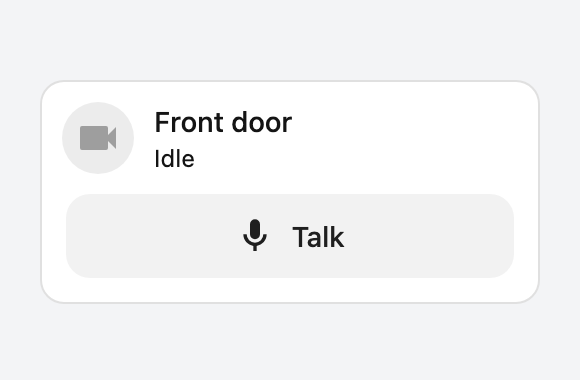
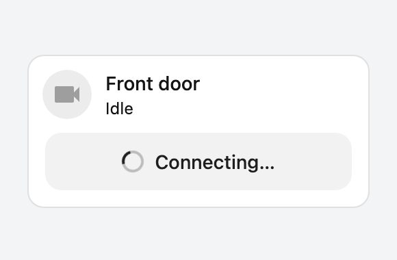
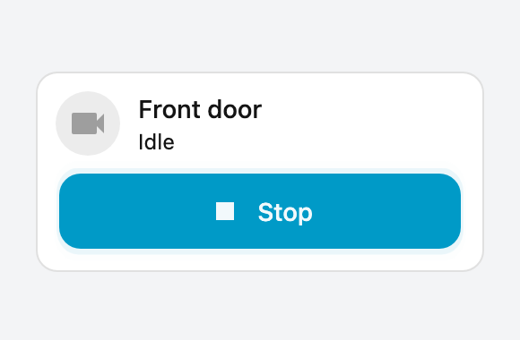
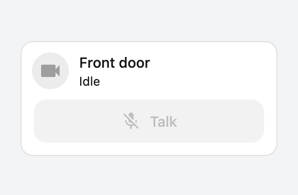

# Push to talk for the Home Assistant tile card

[](https://my.home-assistant.io/redirect/hacs_repository/?category=plugin&repository=ha-push-to-talk-card&owner=timoptr)

A talk button for the Home Assistant [tile card](https://www.home-assistant.io/dashboards/tile/). One tap opens an audio connection to a camera, so you hear the camera and the camera hears you. Another tap hangs up.

Home Assistant 2026.11 added two-way audio for cameras, but only inside the camera's more-info dialog. This feature puts it on your dashboard, on any tile: the camera's own tile, the tile of the lock next to it, or anything else.

It is audio only. No video is requested or shown.

## Screenshots

| Ready                                                                                                                                                                                 | Connecting                                                                                                                                                                                                        | Talking                                                                                                                                                                                               | Can't talk                                                                                                                                                                                                              |
| ------------------------------------------------------------------------------------------------------------------------------------------------------------------------------------- | ----------------------------------------------------------------------------------------------------------------------------------------------------------------------------------------------------------------- | ----------------------------------------------------------------------------------------------------------------------------------------------------------------------------------------------------- | ----------------------------------------------------------------------------------------------------------------------------------------------------------------------------------------------------------------------- |
| <picture><source media="(prefers-color-scheme: dark)" srcset="docs/images/idle-dark.png"></picture> | <picture><source media="(prefers-color-scheme: dark)" srcset="docs/images/connecting-dark.png"></picture> | <picture><source media="(prefers-color-scheme: dark)" srcset="docs/images/talking-dark.png"></picture> | <picture><source media="(prefers-color-scheme: dark)" srcset="docs/images/cant-talk-dark.png"></picture> |

The button is taken from the development harness, which draws a stand-in for the tile around it. In Home Assistant the tile card draws the header, so the icon, name and state are those of your own entity.

## Requirements

- Home Assistant 2026.11 or newer.
- The **two-way audio** preview feature turned on in **Settings > System > Labs**.
- A camera whose integration supports two-way audio. In 2026.11 that is the Reolink integration.
- Home Assistant opened over HTTPS, or the Home Assistant app. Browsers only give access to the microphone on a secure connection. When Home Assistant is opened over plain HTTP inside the app, the app sends the microphone itself.

## Installation

### HACS (recommended)

Click the button to open your Home Assistant instance with this repository pre-filled:

[](https://my.home-assistant.io/redirect/hacs_repository/?category=plugin&repository=ha-push-to-talk-card&owner=timoptr)

Or add it manually:

1. Open HACS in Home Assistant.
2. Click the three dots menu (top right) > **Custom repositories**.
3. Add this repository URL with type **Dashboard**.
4. Search for "Push to talk tile feature" and install it.
5. Reload your browser.

### Manual

1. Download `ha-push-to-talk-card.js` from the [latest release](https://github.com/TimoPtr/ha-push-to-talk-card/releases/latest).
2. Copy it into the `config/www/` folder of Home Assistant.
3. Go to **Settings > Dashboards**, open the three dots menu > **Resources**, and add `/local/ha-push-to-talk-card.js` as a **JavaScript module**.
4. Reload your browser.

## Usage

In the tile card editor:

1. Open **Features** and select **Add feature**.
2. Pick **Push to talk**.
3. Select the edit button of the feature and choose the camera to talk to. On a tile for a camera you can leave it empty: the tile's own camera is used.

Or in YAML:

```yaml
# On a tile for something else: say which camera to talk to
type: tile
entity: lock.front_door
features:
  - type: custom:push-to-talk-card-feature
    entity: camera.front_door
```

```yaml
# On a tile for the camera itself: no setting needed
type: tile
entity: camera.front_door
features:
  - type: custom:push-to-talk-card-feature
```

| Option   | Description                                                             |
| -------- | ----------------------------------------------------------------------- |
| `entity` | The camera to talk to. Optional when the tile's own entity is a camera. |

The button is filled with the tile's `color` while you talk, or with your theme's primary color when the tile has none.

## Behavior

### When the call ends by itself

An open microphone should never be left behind. The call ends when:

- you tap the button again;
- you leave the view, the dashboard or the page, or open the dashboard editor;
- the browser tab or the app goes to the background;
- the camera becomes unavailable;
- the more-info dialog of that camera opens (it has its own talk button);
- you start talking on another tile (one call per page);
- the app ends its microphone stream;
- the connection to the camera or to Home Assistant is lost.

There is no time limit.

### When the button is muted

A muted button with a crossed-out microphone means talking is not possible right now. Tap it to read why:

- no camera is selected, or the selected camera no longer exists;
- the camera does not support two-way audio, or the preview feature is turned off in Labs;
- Home Assistant is not opened over HTTPS and you are not in a version of the Home Assistant app that can send the microphone;
- you refused access to the microphone. Allow it in your browser or device settings and tap again.

## Limitations

- The request sent to the camera is audio only. A camera that insists on video in the request will refuse it, and you will see "Could not connect to the camera".
- The button is a toggle. There is no hold-to-talk.

## Development

Open the repository in the devcontainer (it provides Node.js and pnpm), then:

```bash
pnpm test         # unit tests
pnpm lint         # ESLint and Prettier
pnpm typecheck    # TypeScript
pnpm build        # dist/ha-push-to-talk-card.js
pnpm dev:harness  # http://localhost:4173/dev/harness.html
```

The harness shows the button inside a stand-in tile, against a simulated camera that answers with a real WebRTC connection in the page. Add `?scenario=idle|connecting|talking|cant-talk|unavailable` and `&theme=dark` to the URL.

## Disclaimer

This feature was built with the help of [Claude](https://claude.ai) (Anthropic).
